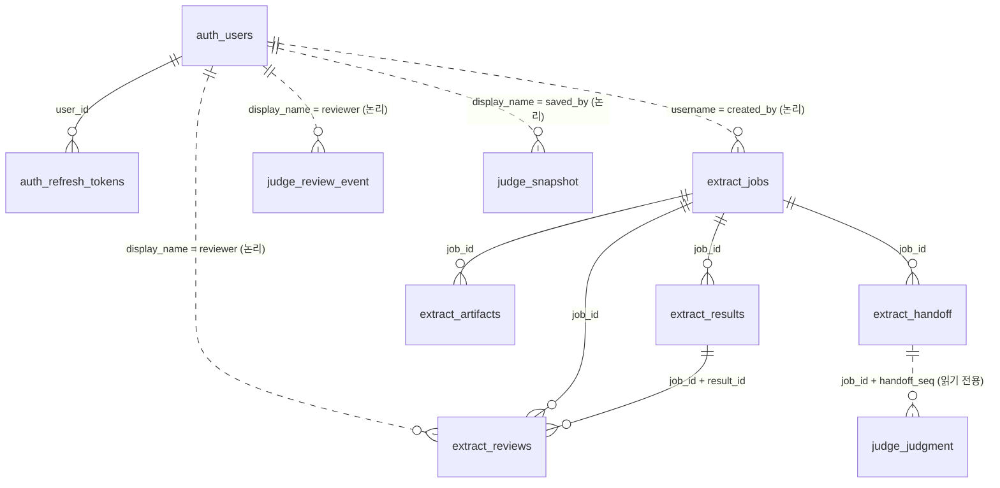

# JWT 로그인 도입: 고칠 곳 정리

작성일: 2026-11-16 · 상태: **1단계(백엔드) 구현함** (브랜치 `nk/auth-jwt`), **3단계(프론트) 구현함** (브랜치 `nk/auth-login-ui`), 2단계(배포) 남음

목표: 지금 "인증 없음"인 서비스에 **JWT 로그인 + 역할 권한**을 넣는다.
순서는 **1단계 백엔드 → 2단계 배포 설정 → 3단계 프론트엔드**이고, 별도 브랜치에서 작업한다.

> **구현하면서 계획과 달라진 점** (아래 본문은 분석 당시 그대로 둔다)
> - `created_by`는 `extract.jobs`에 칸을 추가하지 않고 진행 상태 JSON(`progress_json`, 파일 모드는 `state.json`)에 넣었다. ERD 실행기(`apply_erd_migrations.py`)와 그 시험을 건드리지 않기 위해서다. 칸이 필요해지면 1-8절 방식으로 `a3_0004`를 0007 뒤에 붙인다.
> - `auth` 스키마는 계획대로 ERD 실행기 밖의 `scripts/auth_migrate.py`로 만든다. 서비스 DB ERD 문서(`docs/backend/서비스DB_ERD.md`)는 아직 만들지 않았다.
> - 본문의 `reviewer`는 지우지 않고 **받되 무시**한다(화면 전환 전 호환). 인증 없이 라우터만 붙인 시험 앱에서만 본문 이름을 쓴다(`acting_reviewer`).
> - `POST /api/judgments/_test/handoffs`는 관리자 제한을 걸지 않았다. 이미 `MSDS_JUDGE_TEST_API=1`일 때만 열리고, 판정 시험이 인증 없는 라우터로 부르기 때문이다.
> - DB 없는 파일 모드도 켜지게 했다: 메모리 사용자 저장소 + 실행마다 새로 만드는 임시 키. PostgreSQL 모드는 `MSDS_JWT_SECRET`과 auth 표가 없으면 켜지지 않는다.
> - (프론트) 요청 본문의 `reviewer`는 지우지 않고 로그인한 사람의 이름을 그대로 보낸다. 서버는 무시하고, 화면 안 판정 대역(`judgment-mock.ts`)과 대역 계약(`dev-mock/contract`)이 이 값을 쓰기 때문이다. 그래서 `documents.ts`·`judgment.ts`·`save.ts`의 요청 타입과 대역 계약은 고치지 않았다.
> - (프론트) 가드는 `src/components/shell/auth-gate.tsx`, 머리줄은 `reviewer-badge.tsx`를 지우고 `user-menu.tsx`로 바꿨다. 사용자 관리 화면(`/admin/users/`)도 만들었다.
> - (프론트) 탭 여러 개가 같은 refresh 쿠키로 동시에 갱신하면 서버가 재사용으로 보고 모두 끊으므로, 갱신은 브라우저 잠금(Web Locks)으로 차례를 세우고 10초 안에 다른 탭이 갱신했으면 건너뛴다. 로그인해 있는 동안 20분마다 미리 갱신해, 이 입구를 거치지 않는 PDF 뷰어·새 탭 PDF도 끊기지 않게 했다.

---

## 0. 지금 상태

| 위치 | 지금 | 근거 |
|---|---|---|
| 명세 | "인증·사용자 없음. 검토자 이름은 브라우저에만 있다. 서비스 전환 때 정한다" | [docs/2026-11-01_추출_API_명세.md:501](2026-11-01_추출_API_명세.md) |
| 알려진 한계 | "검토자 이름은 인증 없이 기록 → 기록의 이름을 보증하지 못함" | [docs/2026-11-02_프론트엔드_API_연결_현황.md:60](2026-11-02_프론트엔드_API_연결_현황.md) |
| 접근 제어 | Apache **Basic 인증** 하나(아이디 `to21` 공용 1개) | [deploy/compose/web/httpd.conf](../deploy/compose/web/httpd.conf), [deploy/runpod/demo/pod_app_setup.sh:58-70](../deploy/runpod/demo/pod_app_setup.sh) |
| 검토자 | 요청 본문의 `reviewer` 문자열을 그대로 DB에 기록 | 아래 1-5 표 |
| 프론트 | 검토자 이름을 `localStorage`(`msds.reviewer`)에 저장 | [frontend/src/lib/reviewer.ts](../frontend/src/lib/reviewer.ts) |
| 백엔드 의존성 | JWT·비밀번호 해시 라이브러리 없음 | [backend/pyproject.toml](../backend/pyproject.toml) |
| DB | 사용자 표 없음. `extract`, `judge` 스키마만 있음 | [backend/migrations/](../backend/migrations) |

즉 **"누가 했는지"를 클라이언트가 주장하는 구조**다. 로그인을 넣으면 검토자는 토큰에서 서버가 정하게 바뀌어야 하고, 이 부분이 실제 수정량의 대부분이다.

### 앱 구성 (인증을 어디에 걸지 결정하는 데 필요)

```
브라우저 ─▶ Apache(:8080, Basic) ─▶ extract_app(:8020)
                                     ├ /api/health, /api/documents/...   (routers/extract/*)
                                     ├ /api/judgments/...                (judge_app.router, MSDS_JUDGE_IN_EXTRACT_APP=1)
                                     └ /  → frontend/out 정적 파일
별도 앱(외부 비공개): judge_app(:8011 단독), htodb_app(:8010, 읽기 전용), extraction_app(/api/v1, 내부용)
```

---

## 1단계: 백엔드

### 1-1. 설계 결정 (먼저 정할 것)

| 항목 | 권장 | 이유 |
|---|---|---|
| 토큰 운반 | **HttpOnly 쿠키** (`Authorization: Bearer`도 함께 허용) | 아래 "쿠키를 권하는 이유" 참고 |
| 토큰 종류 | access 15~30분 + refresh 7일 | refresh는 DB에 저장해 로그아웃·강제 만료 가능 |
| 서명 | HS256, 비밀키는 `MSDS_JWT_SECRET` 환경변수 | 서버 한 대 구성이라 대칭키로 충분 |
| 비밀번호 | argon2 또는 bcrypt | |
| 역할 | `admin`, `reviewer` (필요하면 `viewer`) | 채용공고의 "인증·권한" 대응 |
| 문서 소유 | 팀 공용(모두 조회) + `created_by` 기록만 | 검수 도구라 문서 격리는 과함. 필요하면 나중에 필터 |

**쿠키를 권하는 이유** (이 프로젝트 코드 때문에 생기는 제약):

1. **PDF·새 탭은 헤더를 못 붙인다.** `pdfUrl()`을 pdf.js에 URL로 넘기고([pdf-viewer.tsx:28](../frontend/src/components/extract/pdf-viewer.tsx#L28)), `<a href>`로 새 탭에서 연다([pdf-viewer.tsx:317](../frontend/src/components/extract/pdf-viewer.tsx#L317)). 리포트도 `window.open`을 쓴다([save-body.tsx:252,293](../frontend/src/components/save/save-body.tsx#L252)). Bearer 헤더 방식이면 이 경로들이 전부 401이 된다.
2. **Apache Basic 인증과 `Authorization` 헤더가 겹친다.** Basic을 남겨 두고 fetch에 Bearer를 넣으면 Apache가 401을 낸다. 쿠키면 둘이 충돌하지 않는다(그래도 Basic은 2단계에서 빼는 것을 권장).
3. 화면이 같은 출처(`/`, `/api`)에서 나가므로 `SameSite=Strict` 쿠키로 CSRF 위험이 작다.

Bearer도 받게 두면 Swagger(`/docs`)나 스크립트에서 쓰기 편하다.

### 1-2. 새로 만들 파일

| 파일 | 내용 |
|---|---|
| `backend/src/msds/auth/__init__.py` | 패키지 |
| `backend/src/msds/auth/security.py` | 비밀번호 해시/검증, JWT 발급/검증(`exp`, `sub`, `role`, `jti`, `type=access|refresh`) |
| `backend/src/msds/auth/store.py` | `UserStore`(PostgreSQL): 사용자 조회·생성·비활성, refresh 토큰 저장·폐기. 시험용 메모리 구현도 함께 ([tests/contracts/fakes.py](../backend/tests/contracts/fakes.py) 방식) |
| `backend/src/msds/auth/deps.py` | `current_user`(쿠키 → Bearer 순으로 읽음, 401), `require_role("admin")`(403) |
| `backend/src/msds/api/routers/auth.py` | 아래 엔드포인트 |
| `backend/migrations/auth_0001_users.sql` | 아래 표 |
| `backend/migrations/a3_0004_jobs_created_by.sql` | `extract.jobs`에 `created_by TEXT` 추가 |
| `backend/scripts/auth_migrate.py` | auth 스키마 적용 (b2_migrate.py와 같은 형태) |
| `backend/scripts/create_user.py` | 첫 관리자 만들기 CLI (비밀번호는 출력하지 않음) |
| `backend/tests/test_auth_*.py` | 로그인 성공/실패, 만료, 역할, 검토자 위조 차단 |

**엔드포인트**

| 메서드 | 경로 | 권한 | 비고 |
|---|---|---|---|
| POST | `/api/auth/login` | 공개 | 아이디·비밀번호 → 쿠키 설정, 본문엔 사용자 정보 (+ access token) |
| POST | `/api/auth/refresh` | refresh 쿠키 | 회전(rotation): 쓴 refresh는 폐기 |
| POST | `/api/auth/logout` | 로그인 | refresh 폐기, 쿠키 삭제 |
| GET | `/api/auth/me` | 로그인 | 프론트가 로그인 여부·이름·역할 확인 |
| GET/POST/PATCH | `/api/users` | admin | 목록·추가·비활성·역할 변경·비밀번호 초기화 |

**DB 표 (`auth` 스키마, `msds_service` DB)**

```sql
CREATE SCHEMA IF NOT EXISTS auth;
CREATE TABLE auth.users (
  user_id       bigint GENERATED ALWAYS AS IDENTITY PRIMARY KEY,
  username      text NOT NULL UNIQUE CHECK (username ~ '^[a-z0-9_.-]{3,40}$'),
  display_name  text NOT NULL CHECK (length(display_name) BETWEEN 1 AND 40),  -- 검토 기록에 남는 이름
  password_hash text NOT NULL,
  role          text NOT NULL CHECK (role IN ('admin', 'reviewer')),
  is_active     boolean NOT NULL DEFAULT true,
  created_at    timestamptz NOT NULL DEFAULT now(),
  last_login_at timestamptz
);
CREATE TABLE auth.refresh_tokens (
  jti        text PRIMARY KEY,
  user_id    bigint NOT NULL REFERENCES auth.users (user_id),
  expires_at timestamptz NOT NULL,
  revoked_at timestamptz,
  created_at timestamptz NOT NULL DEFAULT now()
);
```

`display_name`을 40자로 두는 이유: 기존 `reviewer` 칸 제한이 추출 쪽 40자([review.py:24](../backend/src/msds/api/routers/extract/review.py#L24)), DB 50자([a2_0002:34](../backend/migrations/a2_0002_extract_results_reviews_artifacts.sql)), 판정 쪽 50자([judge_app.py:36](../backend/src/msds/api/judge_app.py))라서 작은 쪽에 맞춘다.

> 기존 `extract.reviews.reviewer`, `judge.review_event.reviewer`, `judge.snapshot.saved_by`는 **TEXT 그대로 두고** 값만 토큰의 `display_name`(또는 `username`)으로 채우는 것을 권장. FK로 바꾸면 기존 데이터·handoff 불변 계약을 건드리게 된다.

### 1-3. 의존성 — [backend/pyproject.toml](../backend/pyproject.toml)

폐쇄망 반입 대상이라 `==`로 고정하고 `uv lock` 다시 돌린다.

```toml
"PyJWT==<버전>",          # JWT 발급·검증 (msds/auth)
"argon2-cffi==<버전>",    # 비밀번호 해시 (또는 bcrypt / pwdlib[argon2])
```

### 1-4. 앱 조립 — 인증을 거는 곳

| 파일 | 고칠 내용 |
|---|---|
| [extract_app.py:130-133](../backend/src/msds/api/extract_app.py#L130-L133) | `include_router(router, dependencies=[Depends(current_user)])`로 한 번에 보호. **예외**: `health.router`와 새 `auth.router`는 공개. 판정 라우터(`judge_app.router`)도 같은 의존성으로 |
| [extract_app.py:118-128](../backend/src/msds/api/extract_app.py#L118-L128) | CORS에 `allow_credentials=True` 추가 (개발 서버 3000 → 8020에서 쿠키 보내기). `allow_origins`는 이미 명시 목록이라 그대로 가능 |
| [extract_app.py:62](../backend/src/msds/api/extract_app.py#L62) `lifespan` | `UserStore`를 만들어 `app.state.users`에. `MSDS_JWT_SECRET` 없으면 **켜지지 않게** (기본값 비밀키 금지) |
| [extract_app.py:136](../backend/src/msds/api/extract_app.py#L136) 정적 파일 | 그대로 공개 (로그인 화면을 내려줘야 하므로). 보호는 `/api/*`에서 한다 |
| [extract_app.py](../backend/src/msds/api/extract_app.py) `create_app()` 인자 | 시험용으로 `user_store=None` 인자 추가 (store·worker처럼 주입) |
| [judge_app.py:193-199](../backend/src/msds/api/judge_app.py#L193-L199) 단독 실행 | 단독 앱에도 같은 의존성·CORS 설정. (단독 앱은 내부 개발용이면 문서에 명시만) |
| FastAPI `/docs`, `/openapi.json` | 운영에선 끄거나(`docs_url=None`) admin만. 결정 필요 |

### 1-5. 검토자를 토큰에서 정하기 (핵심 수정)

지금은 본문 `reviewer`를 그대로 저장한다. 모두 `user.display_name`으로 바꾼다. 본문 칸은 **한동안 받되 무시**(프론트 전환 전까지 422가 안 나게)하고, 프론트 전환 뒤 지운다.

| 파일:줄 | 지금 | 바꿀 것 |
|---|---|---|
| [routers/extract/review.py:24](../backend/src/msds/api/routers/extract/review.py#L24) `FieldReview.reviewer` | 필수 | 선택 → 이후 삭제 |
| [routers/extract/review.py:72](../backend/src/msds/api/routers/extract/review.py#L72) | `body.reviewer.strip()` | `user.display_name` |
| [routers/extract/review.py:37](../backend/src/msds/api/routers/extract/review.py#L37), [:97](../backend/src/msds/api/routers/extract/review.py#L97) `SectionReview` | 같음 | 같음 |
| [routers/extract/storage.py:110-120](../backend/src/msds/api/routers/extract/storage.py#L110-L120) `ToJudgment` | 본문 `reviewer` (실제로는 안 씀) | 본문 없애고 로그 용도로 user 기록 |
| [judge_app.py:46](../backend/src/msds/api/judge_app.py#L46), [:148](../backend/src/msds/api/judge_app.py#L148) `ReviewEventRequest` | 본문 `reviewer` | user에서 |
| [judge_app.py:59](../backend/src/msds/api/judge_app.py#L59), [:153](../backend/src/msds/api/judge_app.py#L153) `SaveRequest` → `saved_by` | 본문 `reviewer` | user에서 |

서비스 계층([service/review.py:130,152](../backend/src/msds/service/review.py#L130), [judge/service.py:388,462](../backend/src/msds/judge/service.py#L388))은 이미 `reviewer: str`을 인자로 받으므로 **고칠 필요 없음**. 라우터에서 넘기는 값만 바뀐다.

### 1-6. 권한(역할)을 거는 곳

| 엔드포인트 | 권한 | 파일 |
|---|---|---|
| 문서 목록·조회·업로드·검수·판정 처리·저장·리포트 | reviewer 이상 | routers/extract/*, judge_app |
| `POST /api/documents/{id}/retry` | reviewer (원하면 admin) | [jobs.py:129](../backend/src/msds/api/routers/extract/jobs.py#L129) |
| `POST .../results/persist`, `POST .../handoffs` (운영자용 수동 작업) | **admin** | [storage.py:27](../backend/src/msds/api/routers/extract/storage.py#L27), [:123](../backend/src/msds/api/routers/extract/storage.py#L123) |
| `POST /api/judgments/_test/handoffs` | admin + 기존 `MSDS_JUDGE_TEST_API=1` | [judge_app.py:103](../backend/src/msds/api/judge_app.py#L103) |
| `/api/users/*` | admin | 새 파일 |
| `/api/health` | 공개 (compose healthcheck가 씀, [compose.yaml](../deploy/compose/compose.yaml) app.healthcheck) | [health.py](../backend/src/msds/api/routers/extract/health.py) |

### 1-7. 업로드한 사람 기록

| 파일 | 고칠 내용 |
|---|---|
| [routers/extract/jobs.py:75](../backend/src/msds/api/routers/extract/jobs.py#L75) `upload()` | `user`를 받아 `store.create(..., created_by=user.username)` |
| [service/jobs.py:188](../backend/src/msds/service/jobs.py#L188) `PostgresJobStore.create` | `created_by` 인자 → INSERT에 칸 추가 |
| [service/store.py:59](../backend/src/msds/service/store.py#L59) `DocumentStore.create` (파일 저장소) | 같은 인자 받고 state JSON에 저장 (시그니처 맞춤) |
| [service/progress.py](../backend/src/msds/service/progress.py) `view`/`summary_view` | 응답에 `created_by` 추가 (선택) |
| 목록 필터 `?mine=true` | 선택. [jobs.py:102](../backend/src/msds/api/routers/extract/jobs.py#L102) |

> 주의: [backend/src/msds/preprocess/jobs.py](../backend/src/msds/preprocess/jobs.py)는 지금 main에 수정 중인 변경이 있다. 이번 작업 대상은 `service/jobs.py`이지 `preprocess/jobs.py`가 아니다(이름이 비슷함).

### 1-8. ERD·마이그레이션 실행기 수정

이 저장소에서 "ERD"는 두 가지를 가리킨다. 둘 다 손봐야 한다.

**(1) ERD 마이그레이션 실행기:** [scripts/apply_erd_migrations.py](../backend/scripts/apply_erd_migrations.py)

`extract` 스키마의 SQL을 순서대로 적용하고, 적용할 때마다 sha와 **스키마 지문**(`schema_fingerprint`)을 `to21_erd_control.migration_history`에 남긴다. 기록과 실제 DB가 다르면 멈춘다. 코드에서 확인한 제약은 다음과 같다.

| 줄 | 동작 | 이번 작업에 주는 영향 |
|---|---|---|
| [:24-29](../backend/scripts/apply_erd_migrations.py#L24-L29) `MIGRATION_FILES` | 고정 튜플 | `a3_0004_jobs_created_by.sql`을 추가해야 함 |
| [:30](../backend/scripts/apply_erd_migrations.py#L30) `GRANTS_FILE = MIGRATION_FILES[-1]` | 마지막 파일을 권한 파일로 간주 | 새 파일을 **뒤에 붙이면 새 파일이 권한 파일로 잘못 잡힌다** → `GRANTS_FILE = "0007_service_grants.sql"`처럼 이름으로 고정해야 함 |
| [:277](../backend/scripts/apply_erd_migrations.py#L277) 이력 순서 검사 | 이력이 목록의 **앞부분과 정확히 같아야** 함 | 이미 설치된 DB가 있으므로 새 파일은 **반드시 0007 뒤에** 붙인다 (앞에 끼우면 "이력 순서가 불완전합니다"로 멈춤) |
| [:175-215](../backend/scripts/apply_erd_migrations.py#L175-L215) `schema_fingerprint` | **`extract` 스키마만** 지문에 넣음 | `created_by` 칸 추가는 새 지문으로 기록되니 문제없음. 단 **`auth` 스키마는 이 실행기가 추적하지 못함** |
| [:129-156](../backend/scripts/apply_erd_migrations.py#L129-L156) 권한 경계 검사 | 판정 역할은 `extract.handoff` 읽기만 가능해야 함 | 칸 추가는 영향 없음 |

**권장 분리** (B가 `judge`를 [b2_migrate.py](../backend/scripts/b2_migrate.py)로 따로 관리하는 방식과 같게):
- `extract.jobs.created_by` → **ERD 실행기**에 `a3_0004_jobs_created_by.sql`로 추가 (`extract`는 A 소유이므로)
- `auth` 스키마 → **별도 실행기** `auth_migrate.py` (`auth_0001_users.sql`, 필요하면 auth 전용 권한 SQL)
- 실행 순서([deploy/compose/app/migrate.sh](../deploy/compose/app/migrate.sh)): `apply_erd_migrations.py` → `b2_migrate.py` → `auth_migrate.py` → `create_user.py --if-missing`

`created_by`를 `auth.users`로 FK를 걸면 `extract`가 `auth`에 의존하게 되어 실행 순서가 묶이고 지문 검사에도 섞인다. 그래서 **TEXT(username)로 두고 FK는 걸지 않는다**. 기존 `reviewer`/`saved_by` 칸과 같은 방식이다.

`auth` 권한: 앱은 지금 `user=kdb`로 붙는다([compose.yaml](../deploy/compose/compose.yaml) `MSDS_SERVICE_DATABASE_URL`). 역할을 분리하려면 `to21_auth` 그룹 역할을 만들고 `auth.users`에 SELECT·INSERT·UPDATE, `auth.refresh_tokens`에 SELECT·INSERT·UPDATE를 준다. 판정 역할(`to21_judge`)에는 권한을 주지 않는다.

같이 고칠 시험·문서:

| 파일 | 고칠 내용 |
|---|---|
| [tests/test_erd_migration_runner.py](../backend/tests/test_erd_migration_runner.py) | 파일 수·`GRANTS_FILE` 가정, 0007 뒤에 붙은 파일이 이미 설치된 DB에 추가로 적용되는 경우 |
| [tests/test_erd_service_migrations.py:21-25](../backend/tests/test_erd_service_migrations.py#L21-L25) `TABLE_FILES` | 새 SQL 추가 (실제 PG 시험, `TO21_ERD_TEST_DATABASE_URL`) |
| [tests/contracts/test_b2_install.py](../backend/tests/contracts/test_b2_install.py) | A 실행기를 다시 돌려도 통과하는지 보는 시험. 새 파일이 생긴 뒤에도 통과하는지 확인 |
| [deploy/htodb/TEAM_SETUP.md:176,187](../deploy/htodb/TEAM_SETUP.md) | "SQL 세 개와 권한 SQL 0007", "적용 이력 4건" → 5건, auth 설치 단계 추가 |
| [docs/A1_작업_흐름_실행.md:28](A1_작업_흐름_실행.md) | DB 준비 명령에 `auth_migrate.py` 추가 |

**(2) ERD 그림 문서**

| 문서 | 다루는 범위 | 할 일 |
|---|---|---|
| [deploy/htodb/ERD.md](../deploy/htodb/ERD.md), [HTODB_ERD_API.html](../deploy/htodb/HTODB_ERD_API.html) | **지식DB(`htodb`, `htodb_map`)만** 다룸. `extract`·`judge`는 없음 | 고칠 필요 없음 (다른 DB이고 범위도 다름) |
| 서비스 DB(`msds_service`) ERD | **지금 없음.** `extract`·`judge` 표 구조는 SQL 파일에만 있다 | **새로 만든다**: `docs/backend/서비스DB_ERD.md` (ERD.md와 같은 Mermaid 방식) |

새 서비스 DB ERD에 넣을 범위 (컬럼은 SQL 기준, 아래는 관계만):



점선(`..`)은 FK 없는 논리 관계다. 사람 이름 칸(`reviewer`, `saved_by`)은 **기록 당시 이름을 그대로 남기는 이력 값**이라 FK를 걸지 않는다는 점을 문서에 적는다. 그래야 사용자 이름을 바꾸거나 비활성으로 돌려도 과거 기록이 바뀌지 않는다. `judge` 쪽 표 이름은 [b2_001_judge.sql](../backend/migrations/b2_001_judge.sql)에서 확인해 맞춘다.

### 1-9. 바꿔야 할 기존 시험

`create_app()`으로 앱을 띄우는 시험은 인증이 걸리면 401이 난다. `app.dependency_overrides[current_user] = lambda: 가짜사용자` 고정물을 [tests/conftest.py](../backend/tests/conftest.py)에 하나 두고 쓰게 바꾼다.

| 시험 | 이유 |
|---|---|
| [test_a1_jobs_api.py](../backend/tests/test_a1_jobs_api.py) | 업로드·목록 |
| [test_E_extract_app.py](../backend/tests/test_E_extract_app.py) | 전체 라우터 |
| [test_E_review.py](../backend/tests/test_E_review.py) | 본문 `reviewer` → 토큰 이름 |
| [test_a2_results.py](../backend/tests/test_a2_results.py) | persist/handoff (admin) |
| [contracts/test_b2_service.py](../backend/tests/contracts/test_b2_service.py) | 판정 라우터, `reviewer`/`saved_by` |
| [test_extraction_api.py](../backend/tests/test_extraction_api.py) | `/api/v1` 앱. 보호할지 결정 후 |

새 시험에 꼭 넣을 것: **본문에 다른 `reviewer`를 넣어도 기록엔 로그인한 사람 이름이 남는지**, 만료 토큰 401, reviewer가 admin 경로 호출 시 403, 비활성 사용자 401, refresh 재사용 거부.

### 1-10. 손대지 않는 곳

- [htodb_app.py](../backend/src/msds/api/htodb_app.py): 내부 읽기 전용 지식DB 조회, 밖으로 안 열림
- [extraction_app.py](../backend/src/msds/api/extraction_app.py) (`/api/v1`): 내부 OCR 작업용. 외부 노출 계획이 없으면 그대로 (노출하면 같은 의존성)
- `judge/worker.py`, `service/worker.py`: 백그라운드 작업자, HTTP 요청이 아님
- `scripts/b_app*.py`: 개발용 작업 화면

---

## 2단계: 배포 설정

| 파일 | 고칠 내용 |
|---|---|
| [deploy/compose/web/httpd.conf](../deploy/compose/web/httpd.conf) | `<Location />`의 Basic 인증 제거 (앱이 인증). 이제 `auth_basic`, `authn_file` 모듈 불필요 |
| [deploy/compose/compose.yaml](../deploy/compose/compose.yaml) `web` | `htpasswd` 명령, `WEB_PASSWORD` 제거 |
| 같은 파일 `app.environment` | `MSDS_JWT_SECRET`, `MSDS_ACCESS_TOKEN_MINUTES`, `MSDS_REFRESH_TOKEN_DAYS`, `MSDS_COOKIE_SECURE`(RunPod 프록시는 https라 1) 추가 |
| [deploy/compose/gen-env.sh](../deploy/compose/gen-env.sh) | `MSDS_JWT_SECRET`, `ADMIN_PASSWORD` 무작위 생성 추가 |
| [deploy/compose/app/migrate.sh](../deploy/compose/app/migrate.sh) | `auth_migrate.py` 실행 + 첫 관리자 생성(`create_user.py --if-missing`) |
| `deploy/compose/.env.example` | 새 변수 견본 |
| [deploy/runpod/demo/pod_app_setup.sh](../deploy/runpod/demo/pod_app_setup.sh) [4]·[5] | 같은 변경 (Basic 제거, 마이그레이션, 관리자) |
| [README.md](../README.md) 13행, 시연 서버 설명 | "Basic 인증" → "로그인(JWT)" |
| [docs/2026-11-01_추출_API_명세.md](2026-11-01_추출_API_명세.md) 341·501행 | 인증 절 추가, "인증 없음" 문구 수정 |

> `deploy/compose/`는 지금 git에 올라가 있지 않다(untracked). 브랜치에 포함할지 먼저 정할 것.

---

## 3단계: 프론트엔드

정적 export(`output: "export"`, [next.config.ts](../frontend/next.config.ts))라 Next 미들웨어·서버 컴포넌트로 막을 수 없다. **클라이언트에서 `/api/auth/me`로 확인하고 `/login`으로 보내는 방식**이 된다(실제 보호는 백엔드가 함).

| 파일 | 고칠 내용 |
|---|---|
| 새 `src/app/login/page.tsx` | 로그인 폼 (React Hook Form + Zod, 기존 패턴) |
| 새 `src/api/auth.ts` | `login`, `logout`, `refresh`, `meQuery` + zod 스키마 |
| 새 `src/providers/auth-provider.tsx` 또는 가드 컴포넌트 | `me` 실패(401) → `/login?next=...` |
| [src/app/layout.tsx](../frontend/src/app/layout.tsx) | 가드 감싸기 (login 페이지 제외) |
| [src/api/client.ts:70](../frontend/src/api/client.ts#L70) `requestJson` | `credentials: "include"`, 401이면 `refresh` 한 번 시도 후 재요청, 실패 시 로그인으로 |
| [src/api/save.ts:115](../frontend/src/api/save.ts#L115), [src/api/judgment-report.ts:14](../frontend/src/api/judgment-report.ts#L14) | 직접 `fetch` 하는 곳. 같은 처리 |
| [src/components/extract/pdf-viewer.tsx:28](../frontend/src/components/extract/pdf-viewer.tsx#L28) | pdf.js `getDocument({ url, withCredentials: true })` (같은 출처면 없어도 됨, 개발 서버용) |
| [src/lib/reviewer.ts](../frontend/src/lib/reviewer.ts) | localStorage 검토자 → **삭제**, `useReviewer()`는 `me.display_name` 반환으로 대체 |
| [src/components/shell/reviewer-badge.tsx](../frontend/src/components/shell/reviewer-badge.tsx) | "검토자 이름 변경" 대화상자 → 사용자 이름 + 로그아웃 |
| [src/components/shell/app-header.tsx](../frontend/src/components/shell/app-header.tsx) | 배지 교체 |
| [src/components/home/upload-form.tsx:48,74-92,125,167](../frontend/src/components/home/upload-form.tsx#L48) | 검토자 입력칸·"검토자 필요" 조건 제거 |
| [src/components/home/document-list.tsx](../frontend/src/components/home/document-list.tsx) | 검토자 의존 조건 정리, (선택) `created_by` 열 |
| [src/api/documents.ts:160-172](../frontend/src/api/documents.ts#L160-L172) | 검수 요청 본문의 `reviewer` 제거 |
| [src/api/judgment.ts:197-204](../frontend/src/api/judgment.ts#L197-L204) `ReviewEventRequest`, [src/api/save.ts:71](../frontend/src/api/save.ts#L71) `SaveRequest` | `reviewer` 제거 |
| 검토자를 읽는 화면들: [values-panel.tsx](../frontend/src/components/review/values-panel.tsx), [hazard-detail.tsx](../frontend/src/components/review/hazard/hazard-detail.tsx), [regulation-detail.tsx](../frontend/src/components/review/regulation/regulation-detail.tsx), [start-judgment.tsx](../frontend/src/components/review/judgment-gate/start-judgment.tsx), [save-body.tsx](../frontend/src/components/save/save-body.tsx), [history-tab.tsx](../frontend/src/components/review/history/history-tab.tsx) | 본문에 넣던 `reviewer` 제거. 응답에 오는 `reviewer`(누가 했는지 표시)는 그대로 |
| [dev-mock/contract/api.ts:31,122,137,146](../frontend/dev-mock/contract/api.ts#L31), [dev-mock/judgment-server.mjs](../frontend/dev-mock/judgment-server.mjs), [src/api/judgment-mock.ts](../frontend/src/api/judgment-mock.ts) | 요청 계약에서 `reviewer` 제거, `/api/auth/*` 대역 추가 |
| (선택) 새 `src/app/admin/users/page.tsx` | 사용자 관리 (admin만) |
| [frontend/.env.example](../frontend/.env.example) | 개발 시 `localhost`로 통일하라는 안내 (쿠키 SameSite는 포트를 무시하므로 `localhost:3000` ↔ `localhost:8020`은 같은 사이트, `127.0.0.1`과 섞으면 쿠키가 안 감) |

---

## 4. 브랜치·작업 순서 제안

> main에 커밋 안 된 변경이 있다: `backend/src/msds/preprocess/jobs.py`(수정), `backend/tests/test_a1_jobs_degraded.py`, `deploy/compose/`(새 파일). 브랜치를 따기 전에 이 변경을 어디에 둘지 먼저 정할 것 (그대로 따면 새 브랜치로 따라온다).

브랜치 이름 예: `feat/auth-jwt` (백엔드) → `feat/auth-jwt-front` (프론트), 또는 하나로.

1. 의존성 추가 + `msds/auth/security.py` + 단위 시험 (DB 없이 돎)
2. `auth_0001_users.sql` + `auth_migrate.py` + `UserStore` + `create_user.py`
3. `/api/auth/*` 라우터 + `current_user` 의존성
4. `extract_app`에 의존성 걸기 + 기존 시험 고정물 수정 → 전체 pytest 통과 확인
5. 검토자 이름을 토큰에서 (1-5) + 위조 차단 시험
6. 역할 권한 (1-6), `created_by` (1-7)
7. 배포 설정 (2단계)
8. 프론트 (3단계): `client.ts` → 로그인 화면·가드 → 검토자 제거 → 목업 계약

---

## 5. 채용공고와 연결되는 포인트 (포트폴리오용)

| 공고 항목 | 이 작업에서 보여줄 것 |
|---|---|
| FastAPI 백엔드 (인증·권한) | JWT access/refresh, 역할 기반 의존성, 검토 기록 위조 차단 |
| PostgreSQL 설계·SQL | `auth` 스키마, 제약조건, refresh 토큰 폐기 표, 스키마별 DB 역할 권한 |
| Docker 패키징·배포 | compose에 비밀값 생성·마이그레이션·첫 관리자 생성 자동화 |
| Linux 서비스 운용 | Apache 리버스 프록시 정리, 비밀키 환경변수 관리 |
